# Vibe知识大赏 风格库（30）

> **版权声明**：下列 Douyin 链接、BGM 曲名与分析数据仅用于风格研究记录；原片与音频**不随本仓库分发**。渲染时请使用你自己拥有授权的 BGM。

数据来源：抖音原片41条（TikHub下载），帧/调色/节奏为实测；字体名、爆点分析、美学分为主观估计。

## 01 星尘时间轴 · Stardust Timeline (`stardust-timeline`)
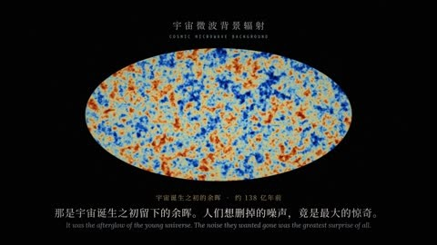

- 参考：[信息论 惊奇之学](https://www.douyin.com/video/7690337875291950345) @电子智人 · 赞 1405890 · 300.0s · 1024x576
- 参考：[37%法则](https://www.douyin.com/video/7691722835458313514) @长留zero · 赞 351642 · 163.0s · 1920x1080
- 画幅：16:9
- 配色（实测底色）：#030305 #080a0e #202123 #434041 #7b655c #a5ae9a；强调色：#964a48 #bf9861 #5083ac；近黑深蓝底(#030305~#0f1015) + 极淡星尘噪点
- 字体：宋体/思源宋体衬线标题(白/暖金)，小号无衬线说明；数学公式用衬线斜体（字体名为目测估计）
- 布局：画面中线一条发光水平时间轴/坐标轴，大数字居中，字幕底部居中
- 动效：光点沿轴滑行、数字滚动计数、粒子汇聚成字、发光曲线逐段描绘
- 转场：淡入淡出 + 镜头沿轴推移（几乎无硬切）
- 节奏：时长300s，硬切1.4/分，视觉大变化0.6/分（3s采样）
- 场景类型：一句诗/一个问题开场、发光轴+游标、大数字计数、公式逐项浮现、波形/信号可视化、收束金句
- 钩子：首句古诗/反问 + 一个光点出现
- 结构：问题→直觉→公式→现实隐喻→金句
- 字幕：底部居中细白宋体，关键字暖金/红高亮
- BGM：950345→other/unknown (shazam:无)；313514→We Never (Remix)/若如初见/开智小曲 系 (shazam:开智小曲)
- 爆点：把抽象数学(信息量/最优停止)变成一条会发光的线；极简+高级感；数字反差(37%)（分析判断）
- 美学分：9/10（主观）

## 02 金线分形·竖屏 · Golden Fractal Vertical (`golden-fractal-vertical`)
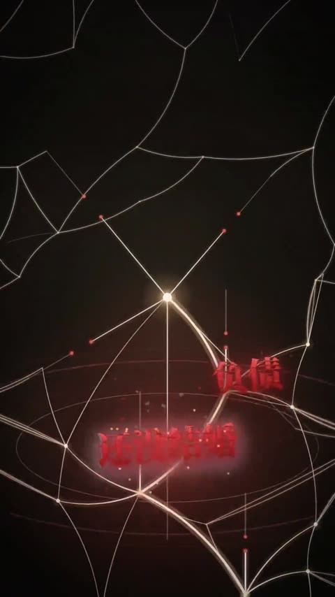

- 参考：[人生的容错率](https://www.douyin.com/video/7697240924837748134) @Nico · 赞 793365 · 130.2s · 1080x1920
- 画幅：9:16
- 配色（实测底色）：#0b0908 #14100d #241d16 #3e332b #605049 #8a7e73；强调色：#7d3132 #a83438 #935b50；暖黑(#0b0908)带暗角
- 字体：细宋体，关键句白+红高亮；数字大号衬线（字体名为目测估计）
- 布局：竖屏中轴一条金线，分叉为树/网，文字围绕节点
- 动效：线条生长、分叉、断裂、网状扩散、点阵矩阵闪烁
- 转场：线条生长串场，淡变
- 节奏：时长130s，硬切0.9/分，视觉大变化0.0/分（3s采样）
- 场景类型：单线人生轴、分叉树、网状人生、点阵统计、U形曲线、收束金句
- 钩子：一句扎心问句+一条竖线
- 结构：单线→分叉→网络→数据→重新理解
- 字幕：上方居中白色宋体，关键词红色
- BGM：748134→We Never (Remix)/若如初见/开智小曲 系 (shazam:开智小曲)
- 爆点：『人生不是一条直线』式治愈哲理 + 竖屏原生，线条隐喻一眼懂（分析判断）
- 美学分：9/10（主观）

## 03 暮色地图史话 · Dusk Map Chronicle (`dusk-map-chronicle`)
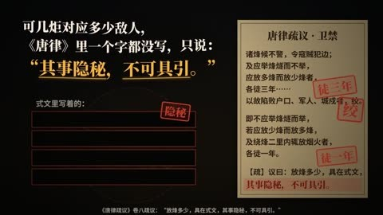

- 参考：[唐朝烽火 平安火](https://www.douyin.com/video/7693231930334855918) @来龙去脉 · 赞 656901 · 233.0s · 1024x576
- 参考：[八百里加急](https://www.douyin.com/video/7692665007733143946) @来龙去脉 · 赞 92142 · 202.0s · 1920x1080
- 画幅：16:9
- 配色（实测底色）：#1c1711 #0b0a0a #2d241b #514131 #7a6851 #ad9d7b；强调色：#7d5734 #9f7b49 #edcc65；沙土色地形图/羊皮纸(#1c1711,#2d241b)，暗角
- 字体：粗宋体大标题，左上叙述文字块，金黄/红色关键字（字体名为目测估计）
- 布局：左上大字叙述 + 中下场景插画(烽燧/驿马/地图路线)
- 动效：路线光点沿地图行进、火光闪烁、数字跳动、卷轴展开
- 转场：推拉镜头 + 叠化
- 节奏：时长233s，硬切0.0/分，视觉大变化5.4/分（3s采样）
- 场景类型：历史地图路线、古籍原文卷轴、计数器(人数/里程)、剪影人物/马、制度示意图
- 钩子：『你以为…其实…』反常识开头
- 结构：设问→史料→制度拆解→数字→升华
- 字幕：左上大段宋体，金/红高亮关键词
- BGM：855918→We Never (Remix)/若如初见/开智小曲 系 (shazam:开智小曲)；143946→We Never (Remix)/若如初见/开智小曲 系 (shazam:开智小曲)
- 爆点：历史冷知识+严谨史料引用+『原来如此』，文史类稳爆（分析判断）
- 美学分：9/10（主观）

## 04 暗室微光 · Dim Room Candlelight (`dim-room-candle`)
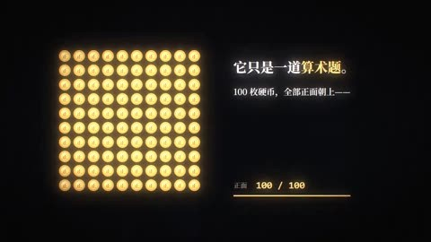

- 参考：[看懂了熵增](https://www.douyin.com/video/7691737108725140762) @比特新语 · 赞 635310 · 170.5s · 1280x720
- 画幅：16:9
- 配色（实测底色）：#08090b #171717 #2e2a26 #51493f #8f826b #d7cfaa；强调色：#856c40 #b29959 #ecdb82；深暗(#08090b)+局部暖光
- 字体：粗宋体巨型汉字(『熵』)，正文白宋，关键词暖黄（字体名为目测估计）
- 布局：中心构图，单一光源照亮物体/人物
- 动效：灯光明灭、像素点阵有序→无序、城市灯火、草木生长
- 转场：渐暗/渐亮转场
- 节奏：时长170s，硬切2.5/分，视觉大变化2.5/分（3s采样）
- 场景类型：房间一盏灯、点阵有序到混乱、城市夜景、人体温度剪影、巨型汉字、公式 S=k·logW
- 钩子：生活场景(房间落灰)+物理问题
- 结构：生活现象→熵概念→公式→宇宙→人生态度
- 字幕：底部居中白宋，关键词暖黄
- BGM：140762→We Never (Remix)/若如初见/开智小曲 系 (shazam:开智小曲)
- 爆点：把物理定律接上『生活的力不从心』，文案治愈；光影氛围强（分析判断）
- 美学分：9/10（主观）

## 05 鎏金年代档案 · Gilded Era Archive (`gold-archive-history`)
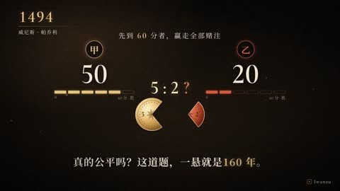

- 参考：[运气的形状](https://www.douyin.com/video/7690344836800913785) @Iwanau · 赞 609542 · 130.0s · 1024x576
- 画幅：16:9
- 配色（实测底色）：#08080a #141210 #27211b #483f35 #786b57 #cfbfa0；强调色：#7b5b3d #9d7f52 #ccac72；暖黑渐变(#08080a→#27211b)
- 字体：衬线英文+中文宋体标题金色，左上大年份数字(1494/1654…)（字体名为目测估计）
- 布局：左上年份戳 + 中央道具/图表 + 右侧信息卡
- 动效：年份滚动、骰子3D旋转、概率树展开、高尔顿板小球下落成正态分布
- 转场：淡入+年份推进
- 节奏：时长130s，硬切0.0/分，视觉大变化1.8/分（3s采样）
- 场景类型：年份标签、3D骰子、手稿/信件、概率树、高尔顿板、正态曲线、π≈3.14
- 钩子：一颗骰子落地+一句提问
- 结构：古罗马→帕斯卡→伯努利→高斯→今天
- 字幕：底部居中小宋体
- BGM：913785→We Never (Remix)/若如初见/开智小曲 系 (shazam:开智小曲)
- 爆点：按年代讲一个数学概念的诞生史，像纪录片；高尔顿板等物理模拟很解压（分析判断）
- 美学分：9/10（主观）

## 06 剪影舞台·信纸 · Silhouette Stage & Paper (`silhouette-stage-paper`)
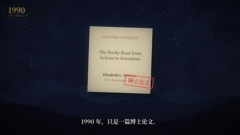

- 参考：[知识诅咒](https://www.douyin.com/video/7692022955122937098) @黑洞科学馆 · 赞 590623 · 145.5s · 1920x1080
- 画幅：16:9
- 配色（实测底色）：#09090b #141318 #25201e #55433b #dbd0b4 #8c7c62；强调色：#a98857 #7f6849 #8e2923；深蓝黑散景背景(#09090b)+暖色舞台地面
- 字体：金色宋体标题，信纸用打字机体，小标签红色印章（字体名为目测估计）
- 布局：舞台式：两个白色棋子小人居中对话，上方道具浮现
- 动效：小人点头/敲击、气泡弹出、方阵复制、纸张飞入、印章盖下
- 转场：淡变+推进
- 节奏：时长146s，硬切0.0/分，视觉大变化3.3/分（3s采样）
- 场景类型：发光小人对话、信纸论文、人群方阵、网格地面、书本/公式、印章
- 钩子：两个小人+一个奇怪实验
- 结构：实验→结果→原理→生活例子→解法
- 字幕：底部居中白字
- BGM：937098→We Never (Remix)/若如初见/开智小曲 系 (shazam:开智小曲)
- 爆点：心理学实验复现(敲歌实验)，小人表演代入感强（分析判断）
- 美学分：8/10（主观）

## 07 雷暴倒计时·竖屏 · Storm Countdown Vertical (`storm-countdown-vertical`)
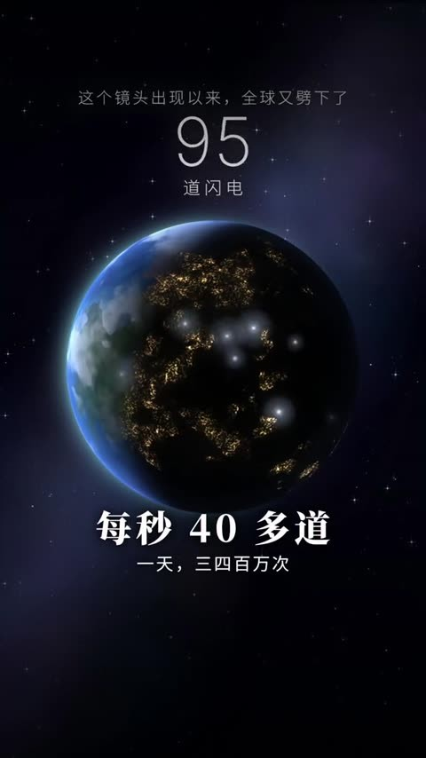

- 参考：[闪电从地面往上打](https://www.douyin.com/video/7694898938109505713) @音辞 · 赞 573869 · 132.0s · 576x1024
- 画幅：9:16
- 配色（实测底色）：#07070f #1a1b2e #2d2f49 #4d516b #7b80a6 #c6cbed；强调色：#4c507d #898cdb #676dac；蓝紫夜空(#1a1b2e,#4d516b)+城市天际线
- 字体：超大等宽计时数字(毫秒)，中号黑体字幕（字体名为目测估计）
- 布局：上部大计时器，中部闪电/地球，底部字幕
- 动效：真实感闪电动画、慢动作、计时器跳动、地球闪电点闪烁
- 转场：闪白、慢放、硬切
- 节奏：时长132s，硬切10.0/分，视觉大变化6.4/分（3s采样）
- 场景类型：毫秒计时、闪电分段慢放、地球夜景、数字对比
- 钩子：『闪电其实是从地面往上打的』反常识
- 结构：反常识→慢放分解→数据→全球视角→回放
- 字幕：中下居中白粗黑体+细注释
- BGM：505713→other/unknown (shazam:Amoureux Solitaires/Apollo)
- 爆点：把0.2秒的闪电放慢讲清楚，计时器制造悬念；竖屏原生（分析判断）
- 美学分：9/10（主观）

## 08 暗金仪表盘 · Bronze HUD Instruments (`bronze-hud-instrument`)
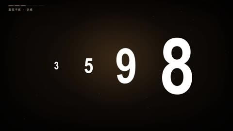

- 参考：[专注力训练](https://www.douyin.com/video/7696889509102816550) @人心有局 · 赞 537242 · 370.4s · 1920x1080
- 参考：[话术博弈](https://www.douyin.com/video/7698325650137976091) @站在外面 · 赞 329846 · 180.3s · 1920x1080
- 画幅：16:9
- 配色（实测底色）：#090604 #171109 #2f2417 #564e3d #908574 #eeebe5；强调色：#90743f #226644 #8e0e15；暖黑(#090604)+细金线框
- 字体：衬线金标题，等宽数字计时，舒尔特方格数字白色（字体名为目测估计）
- 布局：中心一个交互组件(方格/表盘/对话卷宗)，侧边计时器
- 动效：表盘指针旋转、数字跳动、方格逐格点亮、色词Stroop测试
- 转场：缩放进出组件
- 节奏：时长370s，硬切0.2/分，视觉大变化1.0/分（3s采样）
- 场景类型：舒尔特方格、Stroop色词、计时表盘、记忆数字串、对话卷宗、章节大字
- 钩子：『现在开始计时』让观众参与
- 结构：测试1→原理→测试2→原理→总结方法
- 字幕：底部居中小宋，关键词金
- BGM：816550→We Never (Remix)/若如初见/开智小曲 系 (shazam:We Never Beat/开智小曲)；976091→We Never (Remix)/若如初见/开智小曲 系 (shazam:We Never Beat)
- 爆点：可参与的『训练/测试』，观众会停下来跟着做→完播高（分析判断）
- 美学分：9/10（主观）

## 09 白线涂鸦寓言 · White Line Doodle Fable (`white-line-doodle`)
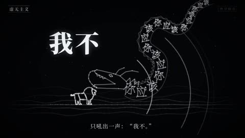

- 参考：[虚无主义？然后呢](https://www.douyin.com/video/7692319542446873700) @叁号暗房 Logos · 赞 525171 · 165.7s · 1920x1080
- 画幅：16:9
- 配色（实测底色）：#030406 #111113 #29292a #444445 #e4e4df #7b7a7a；强调色：#785d38 #8c6f48 #ab8d63；纯黑(#030406)
- 字体：手写感/细宋，白字；巨大标题偶尔描边（字体名为目测估计）
- 布局：大留白，单线白描小人/动物在地平线上行走
- 动效：线条自绘(stroke draw)、小人行走、物体变形、粒子散开
- 转场：淡变 + 镜头横移
- 节奏：时长166s，硬切1.1/分，视觉大变化1.4/分（3s采样）
- 场景类型：地平线、小人推石头/行走、摩天轮/星系、动物寓言、日出
- 钩子：『一切都没意义，然后呢？』
- 结构：问题→哲学家→寓言→翻转→温暖结论
- 字幕：底部居中小白字
- BGM：873700→We Never (Remix)/若如初见/开智小曲 系 (shazam:开智小曲)
- 爆点：存在主义哲学用极简白描寓言讲，留白高级感（分析判断）
- 美学分：8/10（主观）

## 10 俯瞰夜城·青蓝 · Top-down Teal Night City (`teal-night-city-topdown`)
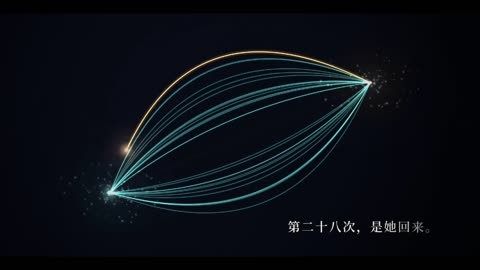

- 参考：[缘分](https://www.douyin.com/video/7694210498786768485) @万象有因 · 赞 515983 · 130.4s · 1280x720
- 画幅：16:9
- 配色（实测底色）：#0c0e17 #040407 #221f21 #3e3d3f #666461 #9c9a93；强调色：#806045 #35918f #5fc7c3；深蓝灰(#0c0e17)+地图网格
- 字体：细衬线标题(『缘分』)，白小字（字体名为目测估计）
- 布局：俯视城市/斑马线/路灯，人物为小圆点
- 动效：圆点移动相遇、轨迹线延伸、概率柱状图生长、两条曲线缠绕
- 转场：镜头俯视推移、淡变
- 节奏：时长130s，硬切0.0/分，视觉大变化4.6/分（3s采样）
- 场景类型：俯视斑马线、路灯下相遇、轨迹线、概率图、交织曲线、暖色收尾
- 钩子：人群俯视+『你们相遇的概率』
- 结构：场景→数据→概率计算→曲线→情感收尾
- 字幕：底部左对齐白小字
- BGM：768485→We Never (Remix)/若如初见/开智小曲 系 (shazam:千年之后 (Claude进行曲)/开智小曲)
- 爆点：把『缘分』算成概率，冷色数据配暖色结局（分析判断）
- 美学分：8/10（主观）

## 11 宇宙粒子大片 · Cosmic Particle Epic (`cosmic-particle-epic`)
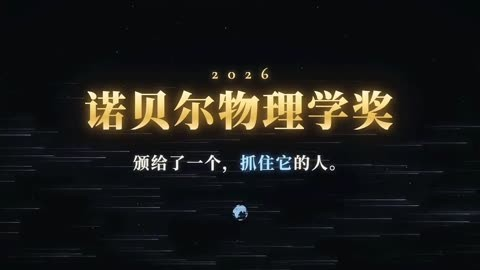

- 参考：[2026诺奖·中微子](https://www.douyin.com/video/7693526422271690406) @无足鸟 · 赞 449814 · 137.9s · 1024x576
- 参考：[2026诺奖·手性](https://www.douyin.com/video/7693880461517615526) @无足鸟 · 赞 129784 · 146.5s · 1280x720
- 画幅：16:9
- 配色（实测底色）：#07090e #171c28 #353f48 #506578 #81939e #b5d6dc；强调色：#476685 #6e9ab2 #a08d57；深空蓝黑(#07090e)+星云
- 字体：鎏金宋体大标题(诺贝尔奖)，衬线英文人名，小号白说明（字体名为目测估计）
- 布局：中心大物体(地球/黑洞/冰立方/手)，标题左/中
- 动效：粒子流、光束穿越、3D网格探测器、霓虹光谱闪烁、镜头飞越
- 转场：光速穿梭、白闪、叠化
- 节奏：时长138s，硬切1.7/分，视觉大变化5.7/分（3s采样）
- 场景类型：诺奖金标题、地球/星系、粒子探测器、光谱柱、人名卡、实验时间线
- 钩子：『每秒650亿个粒子穿过你的指甲』
- 结构：热点→现象→实验→获奖人→意义
- 字幕：底部居中白字，关键词金/蓝
- BGM：690406→We Never (Remix)/若如初见/开智小曲 系 (shazam:开智小曲)；615526→We Never (Remix)/若如初见/开智小曲 系 (shazam:开智小曲)
- 爆点：热点(当年诺奖)+电影级宇宙画面（分析判断）
- 美学分：9/10（主观）

## 12 扁平卡通情景剧 · Flat Cartoon Sitcom (`flat-cartoon-situation`)
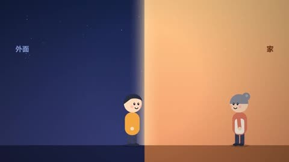

- 参考：[为什么对最亲近的人发脾气](https://www.douyin.com/video/7696886159099661604) @小宇 · 赞 455747 · 149.5s · 1920x1080
- 画幅：16:9
- 配色（实测底色）：#211723 #e1e1d7 #323857 #babab3 #81604d #e1a172；强调色：#e3a674 #9e5b3e #356b89；多场景：夜景蓝、米白、暖黄
- 字体：圆体/粗黑体大标题，关键词橙红，章节胶囊标签（字体名为目测估计）
- 布局：中上大标题+下方卡通人物情景
- 动效：人物表情变化、电量条、进度条、对话气泡弹出
- 转场：场景切换硬切/划像
- 节奏：时长150s，硬切2.0/分，视觉大变化9.2/分（3s采样）
- 场景类型：卡通家庭场景、电量/耐心条、对比表、倒计时、温暖结尾
- 钩子：『为什么我们总把脾气留给最亲近的人』
- 结构：现象→原因(心理学)→场景演示→方法→温暖金句
- 字幕：顶部粗大标题+底部字幕
- BGM：661604→We Never (Remix)/若如初见/开智小曲 系 (shazam:开智小曲)
- 爆点：情感共鸣题+卡通角色，像动画短片，老少皆宜（分析判断）
- 美学分：8/10（主观）

## 13 星空配对图谱 · Starry Matching Graph (`starry-matchmaking-graph`)
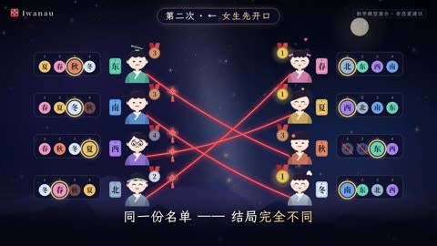

- 参考：[月老的算法](https://www.douyin.com/video/7690785624487590054) @Iwanau · 赞 420566 · 143.3s · 1280x720
- 画幅：16:9
- 配色（实测底色）：#121430 #080816 #232446 #4c4259 #897f87 #d8cbc4；强调色：#634662 #b47e60 #6384ae；紫蓝星空(#121430)+月亮
- 字体：书法/毛笔标题(『月老的算法』)，金色手写金句（字体名为目测估计）
- 布局：左右两列人物头像，中间红线连接
- 动效：红线连接/断开、配对算法逐轮演算、月亮升起
- 转场：淡变+算法轮次推进
- 节奏：时长143s，硬切0.0/分，视觉大变化4.6/分（3s采样）
- 场景类型：月亮夜空、左右配对表、红线连接、论文卡、诺奖奖章、金句
- 钩子：『月老是怎么牵红线的？』
- 结构：神话→算法→逐轮演示→结论→浪漫金句
- 字幕：底部居中小字，金句金色书法
- BGM：590054→We Never (Remix)/若如初见/开智小曲 系 (shazam:开智小曲)
- 爆点：用盖尔-沙普利稳定匹配算法讲爱情，算法可视化+浪漫（分析判断）
- 美学分：9/10（主观）

## 14 心电霓虹 · Neon Heart Pulse (`neon-heart-pulse`)
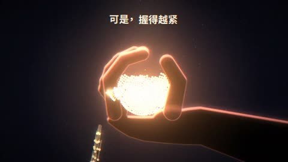

- 参考：[焦虑的本质是活得太用力](https://www.douyin.com/video/7697026270730718514) @仿身骨灰 · 赞 376401 · 80.9s · 1920x1080
- 画幅：16:9
- 配色（实测底色）：#0a0b13 #f8f3ed #30262c #ebe2d7 #695152 #bf938e；强调色：#80584e #e58e7d #4394eb；藏青夜(#0a0b13)，结尾转米白
- 字体：超粗圆角大字(『心』『嗯』)珊瑚粉，正文细黑体（字体名为目测估计）
- 布局：中心大字+横向心电线
- 动效：心电图扫描、手掌捧光粒子、键盘打字、聊天气泡
- 转场：光爆/淡变到亮色
- 节奏：时长81s，硬切4.4/分，视觉大变化5.2/分（3s采样）
- 场景类型：聊天界面、心电图、手捧光、键盘输入、米白结尾
- 钩子：聊天记录截图式开场
- 结构：共鸣场景→心理解释→意象(捧光)→允许自己
- 字幕：中下白字，关键词粉
- BGM：718514→We Never (Remix)/若如初见/开智小曲 系 (shazam:We Never Beat/开智小曲)
- 爆点：焦虑话题+温柔视觉，短(81s)节奏紧（分析判断）
- 美学分：8/10（主观）

## 15 乐理可视化仪表 · Music Theory Visualizer (`music-theory-visualizer`)
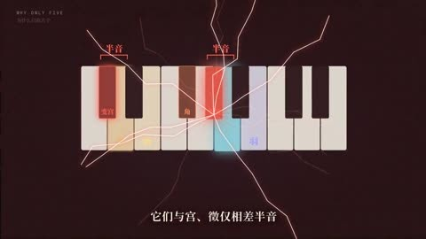

- 参考：[宫商角徵羽](https://www.douyin.com/video/7697671776544804138) @土豆未响应 · 赞 329088 · 104.3s · 1920x1080
- 画幅：16:9
- 配色（实测底色）：#0c0e13 #1a191e #393535 #645c56 #d0cabf #9f9784；强调色：#8c6245 #517ca1 #cea368；深蓝黑(#0c0e13)网格
- 字体：彩色宫商角徵羽汉字(五色)，等宽频率数字（字体名为目测估计）
- 布局：左上编号/频率，中央钢琴键/琴弦/五边形
- 动效：钢琴键点亮、正弦波叠加、比例3:2 Lissajous、柱高跟随音高
- 转场：快速硬切(17次/分)
- 节奏：时长104s，硬切17.3/分，视觉大变化4.6/分（3s采样）
- 场景类型：频率数字、钢琴键盘、正弦波/利萨如、五边形五音、吉他指板、结语清单
- 钩子：『一首歌只用5个音?』
- 结构：五音→频率比→三分损益→钢琴→总结
- 字幕：底部小字幕+大号彩色汉字
- BGM：804138→other/unknown (shazam:Breathing In the Night)
- 爆点：可听可看：每个音同步发声+可视化，知识密度高（分析判断）
- 美学分：9/10（主观）

## 16 金杯光影剧场 · Golden Chalice Cinema (`golden-cup-cinema`)
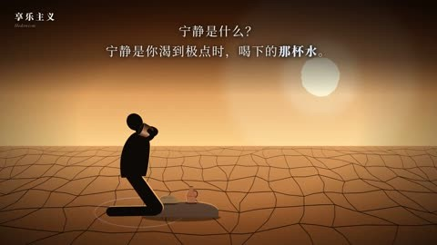

- 参考：[何为享乐主义](https://www.douyin.com/video/7693418695520196836) @叁号暗房 Logos · 赞 254963 · 168.8s · 1920x1080
- 参考：[七宗罪之首：傲慢](https://www.douyin.com/video/7696012982409166187) @叁号暗房 Logos · 赞 170789 · 104.0s · 1920x1080
- 画幅：16:9
- 配色（实测底色）：#080707 #231c18 #473829 #6d5740 #a57f52 #e1ba7f；强调色：#83603b #b08550 #e5b97a；深褐黑(#080707)+舞台聚光金光
- 字体：宋体白字+金色关键词，左上小章节标（字体名为目测估计）
- 布局：舞台化：聚光灯、金杯、剪影人物、雕塑头像
- 动效：金液倒入、光芒放射、剪影动作、聚光灯开合
- 转场：淡变、光芒过曝转场
- 节奏：时长169s，硬切0.7/分，视觉大变化4.3/分（3s采样）
- 场景类型：金杯/金液、聚光灯舞台、石膏头像、剪影人物、沙漠/庭院
- 钩子：『你是否也这样：…』+金液特写
- 结构：误解→哲学家原意→实验→反思→提问
- 字幕：顶部/底部居中宋体
- BGM：196836→We Never (Remix)/若如初见/开智小曲 系 (shazam:开智小曲)；166187→We Never (Remix)/若如初见/开智小曲 系 (shazam:开智小曲)
- 爆点：哲学概念(享乐主义/傲慢)用电影级金色光影包装（分析判断）
- 美学分：9/10（主观）

## 17 3D生物显微 · 3D Bio Microscope (`bio-3d-microscope`)

- 参考：[2026诺奖：光遗传学](https://www.douyin.com/video/7693232955136675072) @宇宙常数 · 赞 163967 · 210.5s · 1024x576
- 画幅：16:9
- 配色（实测底色）：#020306 #121724 #2f3749 #777a84 #adb7d8 #3656a0；强调色：#314b91 #688bd4 #7d9c60；深蓝黑(#020306)+生物荧光
- 字体：粗黑体金色标题，白色小字说明，科学注释线（字体名为目测估计）
- 布局：中央3D神经元/细胞/小鼠，旁边HUD注释
- 动效：神经元电信号流动、细胞膜离子通道开合、镜头推进到微观
- 转场：缩放穿越(宏观→微观)
- 节奏：时长210s，硬切6.0/分，视觉大变化11.1/分（3s采样）
- 场景类型：神经元网络、绿藻细胞、离子通道、3D小鼠、脑区光纤
- 钩子：『一束光打开大脑开关』
- 结构：热点→生物原理→实验→意义
- 字幕：底部白字，关键数字高亮
- BGM：675072→We Never (Remix)/若如初见/开智小曲 系 (shazam:开智小曲)
- 爆点：诺奖热点+高质量3D生物画面，像纪录片（分析判断）
- 美学分：9/10（主观）

## 18 赛博霓虹图标 · Cyber Neon Icons (`cyber-neon-icons`)
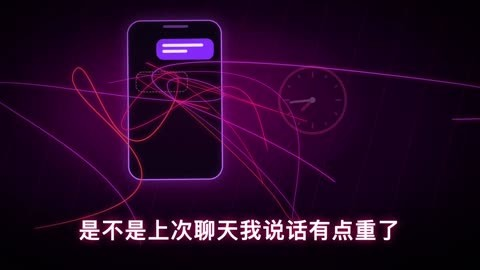

- 参考：[像反派一样思考](https://www.douyin.com/video/7697578828587126025) @人心有局 · 赞 147467 · 341.4s · 1920x1080
- 画幅：16:9
- 配色（实测底色）：#0a0713 #112334 #280627 #586370 #5e1341 #b1acbb；强调色：#7d1d51 #487791 #b85978；紫红/青色渐变暗底(#0a0713,#280627)
- 字体：粗黑体白字+霓虹描边，关键词洋红（字体名为目测估计）
- 布局：中心图标+下方字幕，章节编号卡
- 动效：霓虹线条描绘、图标弹出、车/钥匙等矢量线稿动画、扫描环
- 转场：辉光闪切、快节奏
- 节奏：时长341s，硬切2.1/分，视觉大变化4.2/分（3s采样）
- 场景类型：章节卡01/02、霓虹人物图标、线稿汽车/手机、对勾/进度、雷达环
- 钩子：『反派从不内耗』大字
- 结构：观点→方法1/2/3→案例→升华
- 字幕：中下白粗黑体，关键词霓虹
- BGM：126025→We Never (Remix)/若如初见/开智小曲 系 (shazam:We Never Beat)
- 爆点：职场/心理话题+赛博配色，年轻化强刺激（分析判断）
- 美学分：8/10（主观）

## 19 红色警报·荧光绿 · Red Alert to Lime (`red-alert-lime`)
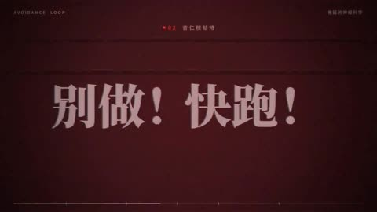

- 参考：[自律](https://www.douyin.com/video/7692657855442214321) @Ember余烬 · 赞 149084 · 110.2s · 1920x1080
- 画幅：16:9
- 配色（实测底色）：#0d0b0e #221817 #c7c5c2 #4e4b40 #8b8a7b #961f27；强调色：#a4222a #779130 #bee340；近黑(#0d0b0e)，前半红色警报光，后半荧光绿
- 字体：粗宋体大字带删除线/划线，计时数字（字体名为目测估计）
- 布局：中心大字+环形计时器
- 动效：红点脉冲、倒计时环、清单逐项勾选、色彩从红转绿
- 转场：闪烁警报、色调切换
- 节奏：时长110s，硬切1.1/分，视觉大变化1.1/分（3s采样）
- 场景类型：环形倒计时、杏仁核示意、清单、10分钟计时器、播放键
- 钩子：『你不是懒』+删除线
- 结构：反驳→大脑机制→方法→立刻行动
- 字幕：中心大字为主
- BGM：214321→other/unknown (shazam:Five Hours/爱是逆局)
- 爆点：『你不是懒』翻转+行动号召，配色从焦虑红到行动绿=情绪叙事（分析判断）
- 美学分：8/10（主观）

## 20 琥珀散景文明史 · Amber Bokeh Civilization (`amber-bokeh-history`)
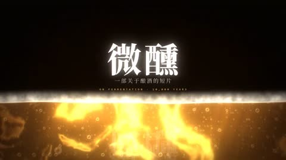

- 参考：[所有文明都酿酒](https://www.douyin.com/video/7692188183110356266) @比特新语 · 赞 109976 · 161.0s · 1280x720
- 画幅：16:9
- 配色（实测底色）：#0d0705 #2e1c11 #5b381e #a76429 #edce76 #88755f；强调色：#824c22 #b77837 #f6d160；琥珀褐(#0d0705,#5b381e)+气泡散景
- 字体：宋体白字，关键词金黄，古文明名衬线英文（字体名为目测估计）
- 布局：中心器皿/酒杯 + 背景气泡/麦田
- 动效：气泡上升、液体倒入、麦浪、各文明酒器依次登场
- 转场：叠化、光晕转场
- 节奏：时长161s，硬切4.8/分，视觉大变化5.2/分（3s采样）
- 场景类型：发酵气泡、麦田、古酒器、碰杯、文字墙
- 钩子：『为什么每个文明都会酿酒？』
- 结构：现象→科学(发酵)→各文明→人性→微醺金句
- 字幕：底部居中白字
- BGM：356266→We Never (Remix)/若如初见/开智小曲 系 (shazam:开智小曲)
- 爆点：『所有文明都酿酒』大历史视角+治愈收尾，色调极统一（分析判断）
- 美学分：9/10（主观）

## 21 草原剪影·竖屏 · Savanna Silhouette Vertical (`savanna-silhouette-vertical`)
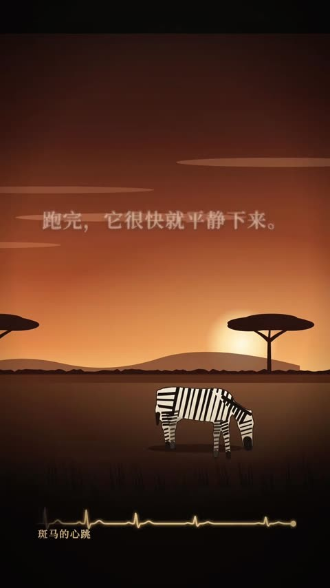

- 参考：[给不会来的狮子站岗](https://www.douyin.com/video/7698690169096782538) @Nico · 赞 109313 · 99.0s · 720x1280
- 画幅：9:16
- 配色（实测底色）：#0c0908 #2b1b1a #51332b #9c4b31 #d29260 #7b6658；强调色：#86402d #ad6341 #db9357；日落橙(#9c4b31,#d29260)/夜蓝卧室
- 字体：宋体白字，红色大号数字(232次)（字体名为目测估计）
- 布局：上方文字，下方剪影场景(斑马/狮子/卧室)
- 动效：太阳落下、斑马吃草、心电线、点阵计数
- 转场：场景交替(草原↔卧室)
- 节奏：时长99s，硬切1.8/分，视觉大变化6.1/分（3s采样）
- 场景类型：非洲草原剪影、深夜卧室、红色计数点阵、心电线
- 钩子：『这件事一件都没发生，你却想了一百遍』
- 结构：人类场景→动物对照→进化解释→数据→释怀
- 字幕：上中白宋
- BGM：782538→We Never (Remix)/若如初见/开智小曲 系 (shazam:开智小曲)
- 爆点：焦虑=给不会来的狮子站岗，隐喻强+竖屏（分析判断）
- 美学分：9/10（主观）

## 22 像素RPG对话 · Pixel RPG Dialogue (`pixel-rpg-dialogue`)
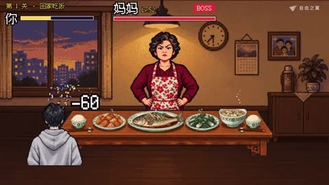

- 参考：[非暴力沟通](https://www.douyin.com/video/7697181453029738171) @致愛麗絲 · 赞 105834 · 134.3s · 1280x720
- 画幅：16:9
- 配色（实测底色）：#160f19 #4a281f #8b5435 #1f214a #554e56 #bf9a72；强调色：#7e482f #a5653e #c9975f；像素风暖色家庭场景(#4a281f,#1f214a)
- 字体：像素字体对话框，蓝色UI面板（字体名为目测估计）
- 布局：游戏画面：角色立绘+底部对话框+右侧选项/属性栏
- 动效：对话逐字打出、选项高亮、GAME OVER、关卡完成
- 转场：游戏式黑屏/READY
- 节奏：时长134s，硬切11.2/分，视觉大变化9.8/分（3s采样）
- 场景类型：对话框、选项菜单、血条/状态、关卡通关、真实菜品特写
- 钩子：『第一关：回家』+妈妈对话
- 结构：关卡1失败→学方法→重试成功→总结四要素
- 字幕：游戏对话框即字幕
- BGM：738171→We Never (Remix)/若如初见/开智小曲 系 (shazam:开智小曲)
- 爆点：把『非暴力沟通』做成可选择的游戏关卡，游戏化强互动感（分析判断）
- 美学分：8/10（主观）

## 23 剪影演化史 · Evolution Silhouette Saga (`evolution-silhouette`)
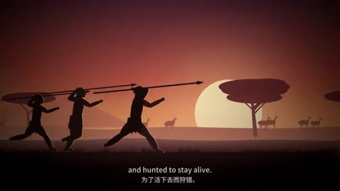

- 参考：[从海里爬上岸的那条鱼](https://www.douyin.com/video/7696111289969560872) @码点小人 · 赞 67351 · 93.6s · 1280x720
- 画幅：16:9
- 配色（实测底色）：#080607 #282425 #473f3f #695c5a #8f7d78 #b5a9aa；强调色：#855c48 #b6856a #407a81；分时代渐变天空：紫粉/绿/橙/蓝灰
- 字体：中英双语小字幕底部（字体名为目测估计）
- 布局：全幅剪影横版卷轴，人物在前景行走
- 动效：角色持续向右走，背景时代变换(海洋→陆地→战争→城市)
- 转场：连续横向卷轴、时代叠化
- 节奏：时长94s，硬切1.9/分，视觉大变化13.5/分（3s采样）
- 场景类型：海洋鱼、恐龙丛林、原始人狩猎、工业战争、核爆、父子剪影
- 钩子：『很久以前，一条鱼爬上岸』
- 结构：时间线顺叙→高潮(战争)→温情结尾
- 字幕：底部中英双语小字
- BGM：560872→other/unknown (shazam:The song of Monster (feat. Hatsune Miku))
- 爆点：一镜到底讲完生命史，情绪向+音乐驱动（分析判断）
- 美学分：9/10（主观）

## 24 霓虹光环侧影 · Neon Halo Profile (`neon-halo-profile`)
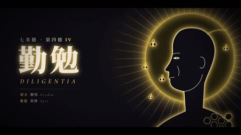

- 参考：[七美德](https://www.douyin.com/video/7699336324809067817) @San · 赞 62786 · 50.2s · 1920x1080
- 参考：[七宗罪 人类情绪七种色彩](https://www.douyin.com/video/7699133250077314304) @San · 赞 44302 · 50.2s · 1920x1080
- 画幅：16:9
- 配色（实测底色）：#100e14 #050407 #262328 #46474b #7b766f #ccc0b5；强调色：#84674a #b29162 #4d707f；近黑紫(#0e0c13)
- 字体：粗宋体大字带RGB色差/霓虹描边，衬线英文小字（字体名为目测估计）
- 布局：右侧人头侧影+光环，左侧大字标题
- 动效：光环发光变色、人物线条描绘、色差抖动
- 转场：快切(~48次/分)
- 节奏：时长50s，硬切49.0/分，视觉大变化4.8/分（3s采样）
- 场景类型：七个章节逐一、人头侧影、引语卡、合集结尾
- 钩子：标题『七种色彩』+快切
- 结构：七项逐一点名→引语→合集
- 字幕：左侧大字为主
- BGM：067817→other/unknown (shazam:Renegade (Piano Mix)/人生志在一博)；314304→other/unknown (shazam:Renegade (Piano Mix)/人生志在一博)
- 爆点：『七宗罪/七美德』系列化，色彩对应情绪，短(50s)高密度（分析判断）
- 美学分：8/10（主观）

## 25 节拍拆解·竖屏 · Beat Breakdown Vertical (`beat-breakdown-vertical`)
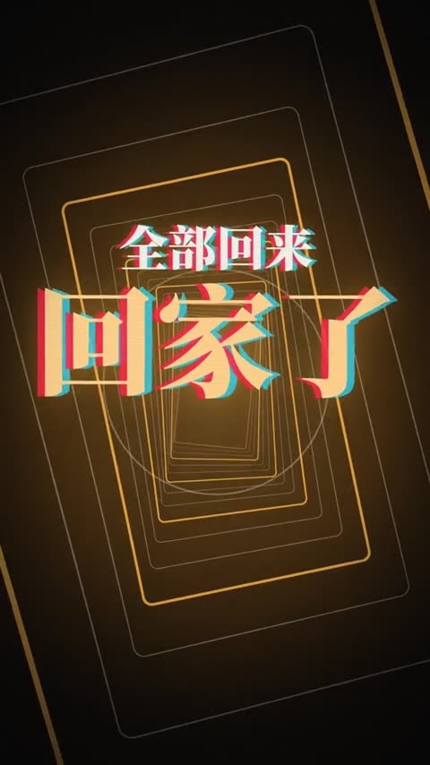

- 参考：[最火的那首BGM](https://www.douyin.com/video/7697546640952970532) @freedomkey · 赞 51923 · 160.0s · 576x1024
- 画幅：9:16
- 配色（实测底色）：#0c0a09 #221911 #453421 #6e5a45 #ae9171 #e0cfb9；强调色：#845c36 #c08951 #f0c181；暖黑(#0c0a09)+金色光圈
- 字体：超大粗衬线数字(113 BPM)，金白宋体（字体名为目测估计）
- 布局：竖屏居中大圆形计数器，上方标题
- 动效：圆环计数、钢琴键高亮、和弦进行阶梯、卡片倾斜叠放
- 转场：光芒迸发、卡片翻转
- 节奏：时长160s，硬切19.1/分，视觉大变化3.4/分（3s采样）
- 场景类型：BPM大数字、圆环拍子计数、钢琴卷帘、和弦阶梯图、总结卡
- 钩子：『为什么？』+BGM本身
- 结构：现象→BPM→和弦循环→心理→结论
- 字幕：居中大字
- BGM：970532→We Never (Remix)/若如初见/开智小曲 系 (shazam:开智小曲)
- 爆点：拆解『vibe知识大赏为什么都用这首BGM』，元话题自带流量（分析判断）
- 美学分：9/10（主观）

## 26 器官信息卡 · Organ Infographic Cards (`organ-infocard-dark`)
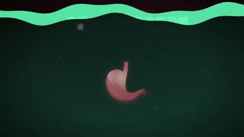

- 参考：[养胃误区](https://www.douyin.com/video/7698983598958841097) @我是风流帅 · 赞 44200 · 135.8s · 1920x1080
- 画幅：16:9
- 配色（实测底色）：#191011 #112320 #352c28 #5c6d5f #c3b6a8 #ae444f；强调色：#9d3644 #d87d6d #4aa178；墨绿/暗红交替(#112320,#191011)
- 字体：圆角粗黑体标题，红色标签『误区』，数据卡片（字体名为目测估计）
- 布局：左侧器官/食物插画，右侧数据卡片面板
- 动效：卡片滑入、柱条增长、温度计、胃壁显微、勾叉判定
- 转场：面板切换、色调翻转
- 节奏：时长136s，硬切1.3/分，视觉大变化2.2/分（3s采样）
- 场景类型：食物三选一、胃部显微、数据卡、误区/真相对比、习惯清单
- 钩子：『这三样你吃了多少？』
- 结构：误区1/2/3→真相→该怎么做→金句
- 字幕：顶部标题+卡片内文字
- BGM：841097→We Never (Remix)/若如初见/开智小曲 系 (shazam:We Never Beat/开智小曲)
- 爆点：健康误区+清晰信息卡，实用收藏（分析判断）
- 美学分：8/10（主观）

## 27 黑板教室数据 · Chalkboard Classroom Data (`chalkboard-classroom`)
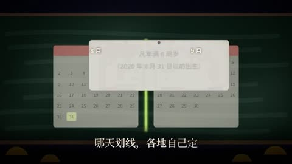

- 参考：[小时候总被说慢](https://www.douyin.com/video/7698565783005220137) @硅基物语 · 赞 20009 · 160.6s · 1280x720
- 画幅：16:9
- 配色（实测底色）：#0f1c16 #040607 #1d2c26 #4d5848 #8a907d #cdc9c0；强调色：#6b7c3e #96a351 #547e86；墨绿黑板(#0f1c16,#1d2c26)
- 字体：粉笔手写感+荧光绿数字，课桌小人（字体名为目测估计）
- 布局：黑板为画布，前景一排学生剪影
- 动效：粉笔线绘制、散点图生长、荧光绿分界线移动
- 转场：黑板擦除/推移
- 节奏：时长161s，硬切0.0/分，视觉大变化3.4/分（3s采样）
- 场景类型：教室学生、出生月份分界线、散点/柱状图、研究论文数据、温情结尾
- 钩子：『晚生两分钟，差了一届』
- 结构：故事→数据→研究→机制→安慰
- 字幕：中上白字+荧光绿关键词
- BGM：220137→We Never (Remix)/若如初见/开智小曲 系 (shazam:开智小曲)
- 爆点：『小时候总被说慢』=相对年龄效应，戳中家长与学生（分析判断）
- 美学分：8/10（主观）

## 28 宣纸水墨字效 · Ink Paper Typography (`ink-paper-typography`)
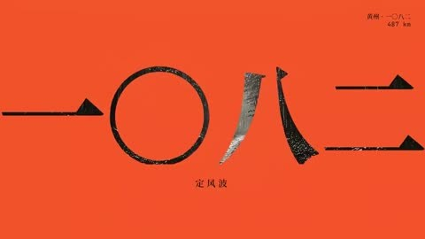

- 参考：[定风波 (Remotion)](https://www.douyin.com/video/7690248321424074417) @风摇叶见蝶 · 赞 19134 · 83.2s · 1024x576
- 画幅：16:9
- 配色（实测底色）：#f5f2eb #12110f #3b3430 #c2bab3 #d3462b #807b76；强调色：#ef532d #a12b22 #e4785b；宣纸米白(#f5f2eb)/墨黑交替，朱红点缀(#d3462b)
- 字体：书法/宋体竖排大字，朱红印章（字体名为目测估计）
- 布局：竖排诗词+大留白，年份大字横排
- 动效：字逐个出现/破碎、墨点扩散、竹林、红色涂层
- 转场：硬切黑白反转、快节奏(21次/分)
- 节奏：时长83s，硬切20.9/分，视觉大变化11.5/分（3s采样）
- 场景类型：竖排诗词、年份大字、竹林雨中人、红色涂抹、金句
- 钩子：『一〇七九 乌台诗案』大字
- 结构：诗→人生事件→诗→翻转金句
- 字幕：竖排为主
- BGM：074417→other/unknown (shazam:无)
- 爆点：苏轼人生+东方美学字效，Remotion代码可实现（分析判断）
- 美学分：9/10（主观）

## 29 希腊陶绘史诗 · Greek Vase Epic (`greek-vase-epic`)
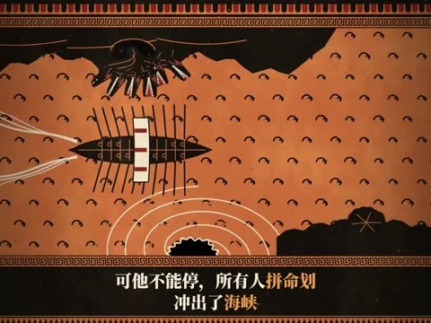

- 参考：[奥德赛 两难的抉择](https://www.douyin.com/video/7699046111025057050) @烬序 · 赞 6265 · 147.5s · 768x576
- 画幅：16:9
- 配色（实测底色）：#19130c #c67948 #774429 #9f5f39 #462c1e #cfbea4；强调色：#c97a47 #81472a #a66138；陶土橙(#c67948)+黑(#19130c)双色
- 字体：宋体白字+橙色关键词，底部回纹边框（字体名为目测估计）
- 布局：古希腊黑绘陶罐风侧视剪影，底部回纹条+字幕
- 动效：船只摇晃、漩涡旋转、怪物伸颈、天平摆动
- 转场：横移+圆形放大镜头
- 节奏：时长148s，硬切8.9/分，视觉大变化13.0/分（3s采样）
- 场景类型：船与海怪、漩涡、天平两难、圆形特写、航海日志
- 钩子：『两头怪物，必须选一个』
- 结构：困境→选择→代价→哲思
- 字幕：底部回纹框内字幕
- BGM：057050→other/unknown (shazam:Golden Accordion Nights)
- 爆点：神话+两难抉择哲思，风格独特一眼识别（分析判断）
- 美学分：9/10（主观）

## 30 灰阶终端数据 · Terminal Grayscale Data (`terminal-gray-data`)
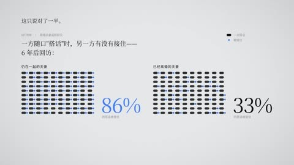

- 参考：[新鲜感的魔咒](https://www.douyin.com/video/7694277028904806730) @我滴个鬼鬼 · 赞 522714 · 115.6s · 1280x720
- 画幅：16:9
- 配色（实测底色）：#07080a #dee0e2 #12181c #282b2e #a6a7aa #514e53；强调色：#475083 #805144 #8eafec；近黑+偶尔纯白反转(#07080a/#dee0e2)
- 字体：大号等宽时钟数字，细黑体小字，蓝色关键词（字体名为目测估计）
- 布局：大留白，左侧小文字，中央容器/点阵
- 动效：聊天气泡逐条出现、水位上升、点阵统计、弹幕飘字
- 转场：黑白反转硬切
- 节奏：时长116s，硬切2.6/分，视觉大变化2.1/分（3s采样）
- 场景类型：时间戳、聊天记录、水杯水位、点阵百分比、弹幕墙、海浪
- 钩子：『23:14』深夜聊天
- 结构：现象→多巴胺→实验数据→方法→结论
- 字幕：左对齐小字
- BGM：806730→other/unknown (shazam:We Never/爱是逆局)
- 爆点：恋爱『新鲜感』用多巴胺水位隐喻，极简冷感（分析判断）
- 美学分：7/10（主观）
